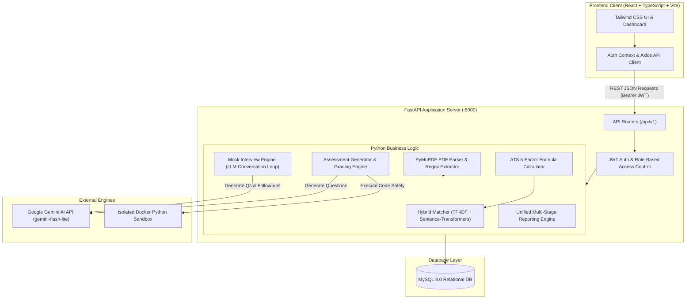
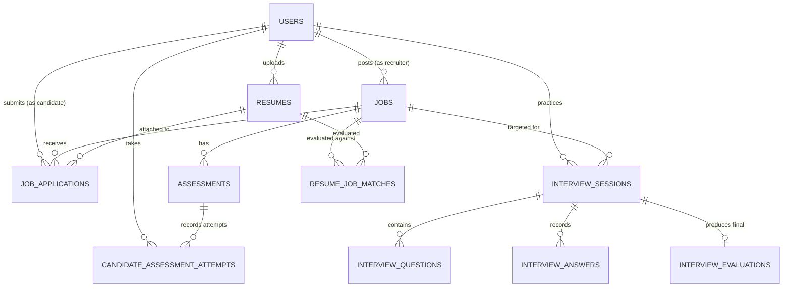

# HireMinds AI — Comprehensive Project Architecture & Codebase Guide

Welcome to the complete, beginner-friendly guide to **HireMinds AI**. This document explains what HireMinds AI is, how it works under the hood, its high-level architecture, every single folder and file in the codebase, and how all the pieces connect together.

---

## Table of Contents
1. [Project Overview in Plain English](#1-project-overview-in-plain-english)
2. [High-Level System Architecture](#2-high-level-system-architecture)
3. [Core Functionalities & How They Work](#3-core-functionalities--how-they-work)
4. [Complete Directory Structure](#4-complete-directory-structure)
5. [Backend File-by-File Deep Dive](#5-backend-file-by-file-deep-dive)
6. [Frontend File-by-File Deep Dive](#6-frontend-file-by-file-deep-dive)
7. [Database Schema & Entity Relationships](#7-database-schema--entity-relationships)
8. [Technology Stack Summary](#8-technology-stack-summary)
9. [How to Run and Test the Project](#9-how-to-run-and-test-the-project)

---

## 1. Project Overview in Plain English

### What is HireMinds AI?
In the traditional job market, when a candidate uploads a resume, it disappears into an **Applicant Tracking System (ATS)**. Most traditional ATS tools act like a black box: they silently reject resumes without explaining why, miss qualified people due to keyword mismatches, or use unfair automated rejection rules.

**HireMinds AI** is an intelligent, ethical, and explainable hiring and interview preparation platform. It serves two distinct groups of people:

1. **Job Seekers (Candidates)**:
   - Upload their PDF resume and view exactly what skills the computer extracts.
   - Correct any mistakes the system made during resume parsing (Human-in-the-Loop).
   - Browse job postings and see an **explainable match score** showing exactly which sentences from their resume matched the job requirements.
   - Take job-tailored **technical quizzes** and **coding challenges** evaluated in a secure sandbox.
   - Practice with an **interactive AI Mock Interviewer** powered by Google Gemini that asks questions one at a time, follows up on candidate answers, grades them with a 4-point rubric, and provides personalized study guides.

2. **Hiring Teams (Recruiters)**:
   - Create, edit, and publish rich job vacancies with mandatory skills, preferred skills, and experience criteria.
   - View applicant rankings backed by concrete textual quotes and evidence, with **zero automated rejections**.
   - Generate custom technical quizzes (MCQ + Python coding challenges) using generative AI with 1 click.
   - View unified applicant evaluation reports combining ATS fit, coding tests, and mock interview transcripts.

### Core Ethical Principles
- **Explainable Metrics**: Every single score (from 0 to 100) comes with sentence-level quotes, mathematical weight breakdowns, and clear explanations.
- **Human-in-the-Loop**: The candidate has the right to review and correct their extracted resume data before any ATS scoring is performed.
- **Zero Automated Rejections**: The system ranks and suggests; a human recruiter always makes the final hiring decision.
- **Separation of Concerns**: Practice mock interview evaluations are strictly separated from ATS filtering tables to guarantee that candidate interview practice never biases recruitment data.

---

## 2. High-Level System Architecture

HireMinds AI follows a modern, decoupled **Client-Server Architecture**:



### Data Flow Lifecycle (Example: AI Mock Interview)
1. **User Action**: The candidate chooses a job posting on the React web app and clicks **Start Practice Interview**.
2. **Client Request**: The frontend calls `POST /api/v1/interviews/start` sending `{ "job_id": 50, "difficulty": "mid" }`.
3. **Backend Authentication**: FastAPI validates the Bearer JWT token, identifies the candidate, and checks MySQL permissions.
4. **AI Generation**: The `interview_service` sends a structured prompt to Google Gemini via `gemini_client.py`.
5. **Database Persistence**: Gemini returns a JSON object with the first question. FastAPI creates an `InterviewSession` and `InterviewQuestion` in MySQL.
6. **Sequential Q&A**:
   - The candidate types their answer in the browser and clicks **Submit**.
   - Gemini grades the answer across 4 dimensions: *Technical Correctness*, *Relevance*, *Clarity*, and *Reasoning* (1.0 to 5.0 scale).
   - Gemini dynamically determines if a follow-up inquiry is needed or if a new competency should be tested, and generates Question #2.
7. **Final Report**: When target question count is reached, the session is completed, generating a personalized study roadmap with strengths, weaknesses, and recommended topics.

---

## 3. Core Functionalities & How They Work

### 1. Authentication & Role-Based Access Control (RBAC)
- **What it does**: Allows users to register and sign in as either a **Candidate** or a **Recruiter**.
- **How it works**:
  - Passwords are encrypted using bcrypt hashing (passwords are never saved in plain text).
  - Successful login generates a stateless JSON Web Token (JWT) signed with a secret key.
  - The frontend stores the token in `localStorage` and automatically attaches it via an Axios request interceptor (`Authorization: Bearer <token>`).
  - React route guards (`RoleRoute.tsx`) protect candidate pages from recruiters and vice versa.

### 2. PDF Resume Extraction & Candidate Verification
- **What it does**: Extracts text, contact information, education, work experience, and technical skills from uploaded PDF resumes.
- **How it works**:
  - `PyMuPDF` (`fitz`) reads the raw text bytes from the PDF file.
  - Regular expressions and specialized skill dictionaries extract recognized programming languages, tools, and libraries.
  - The candidate is presented with a **Review & Correct** screen where they can add missing skills or fix typos before any scoring takes place.

### 3. Dual Matching Engine (TF-IDF + Semantic Transformers)
- **What it does**: Computes how closely a resume matches a job description without relying on simple keyword matching.
- **How it works**:
  - **Lexical Score (TF-IDF)**: Measures exact vocabulary overlaps (e.g., "Docker", "Kubernetes", "PostgreSQL") using Scikit-Learn's TF-IDF vectorizer.
  - **Semantic Score (Deep Embeddings)**: Uses the `all-MiniLM-L6-v2` Sentence-Transformers model to convert resume paragraphs and job requirements into 384-dimensional mathematical vectors. This allows the system to recognize that "AWS ECS" is conceptually related to "Cloud Container Orchestration" even if the exact keywords differ.
  - **Combined Match**: Weights both scores to give an accurate, balanced match percentage.

### 4. 5-Factor Explainable ATS Scoring
- **What it does**: Replaces black-box ATS algorithms with a transparent formula based on 5 dimensions:
  1. **Knowledge & Skills (40%)**: Required and preferred skills coverage.
  2. **Experience (25%)**: Years of experience compared to job requirements.
  3. **Education (15%)**: Degree match (Bachelor's, Master's, PhD).
  4. **Projects & Portfolios (10%)**: Extracted project descriptions matching the role.
  5. **Role-Specific Bonus (10%)**: Specialized certifications and domain fit.
- **Explainability**: Every factor displays the exact supporting sentences extracted from the candidate's resume, plus a list of any missing requirements. Missing data points trigger mathematical renormalization so candidates are never penalized for omitted optional fields.

### 5. Technical Assessments & Docker Sandbox
- **What it does**: Generates job-specific Multiple Choice Questions (MCQs) and Python coding problems, grading them automatically.
- **How it works**:
  - Gemini generates technical questions tailored to the job's required skills.
  - MCQs are graded deterministically against the correct answer keys.
  - Python coding submissions are executed in an isolated, unprivileged **Docker Sandbox** (`coding_sandbox.py`) with strict limits: 5-second CPU timeout, 128MB RAM ceiling, no internet access, and read-only filesystem privileges to prevent malicious code execution.

### 6. Adaptive AI Mock Interviews
- **What it does**: Simulates a live technical interview where the candidate answers questions one by one.
- **How it works**:
  - Gemini generates an initial question based on the job requirements and candidate resume.
  - When the candidate answers, Gemini evaluates the response using a 4-dimension rubric (Technical Correctness, Relevance, Clarity, Reasoning).
  - If the candidate's answer introduces an interesting concept or has a technical gap, Gemini asks a contextual follow-up question.
  - At the end of the session, the candidate receives a comprehensive evaluation with overall summary, demonstrated strengths, growth areas, and recommended study topics.

### 7. Unified Candidate & Recruiter Reports
- **What it does**: Pulls data from all stages into a single, cohesive performance report.
- **How it works**:
  - Aggregates Resume ATS Fit, Assessment Attempt Scores, and Mock Interview evaluations.
  - Generates personalized recommendations for candidates to bridge skill gaps.
  - Provides recruiters with an audit trail showing the rationale behind every metric.

---

## 4. Complete Directory Structure

Below is the layout of the entire workspace:

```text
HireMinds-AI/
├── Explanation.md                             <-- This comprehensive documentation file
├── HireMinds-AI_sprint_1/
│   ├── README.md                              <-- Project setup and overview
│   ├── docs/                                  <-- Technical sprint documentation (Phases 7-11)
│   │   ├── PHASE7_ATS_SCORING.md
│   │   ├── PHASE8_TECHNICAL_ASSESSMENTS.md
│   │   ├── PHASE9_AI_MOCK_INTERVIEWS.md
│   │   ├── PHASE10_REPORTS_AND_INTEGRATION.md
│   │   └── PHASE11_FRONTEND_DEVELOPMENT.md
│   ├── backend/                               <-- FastAPI Python Backend Server
│   │   ├── alembic/                           <-- Database migrations
│   │   ├── alembic.ini                        <-- Migration configuration
│   │   ├── requirements.txt                   <-- Python package dependencies
│   │   ├── .env                               <-- Environment configuration (API keys, DB)
│   │   ├── tests/                             <-- Automated Pytest test suite
│   │   └── app/                               <-- Backend application source code
│   │       ├── main.py                        <-- Application entry point & middleware
│   │       ├── api/                           <-- API routes and dependencies
│   │       ├── core/                          <-- Configuration, database engine, security
│   │       ├── models/                        <-- SQLAlchemy database models
│   │       ├── schemas/                       <-- Pydantic request/response schemas
│   │       └── services/                      <-- Core business logic, ML & AI integration
│   └── frontend/                              <-- Vite + React + TypeScript Frontend
│       ├── package.json                       <-- Frontend dependencies & scripts
│       ├── vite.config.ts                     <-- Vite build and server config
│       ├── tailwind.config.js                 <-- Tailwind CSS styling configuration
│       ├── tsconfig.json                      <-- TypeScript compiler configuration
│       └── src/                               <-- Frontend application source code
│           ├── main.tsx                       <-- Application entry point & DOM mount
│           ├── App.tsx                        <-- Router configuration & navigation guards
│           ├── index.css                      <-- Global styles & Tailwind directives
│           ├── context/                       <-- Global state (Authentication Context)
│           ├── services/                      <-- Axios API communication layers
│           ├── types/                         <-- TypeScript shared interfaces & types
│           ├── components/                    <-- Reusable UI components & layouts
│           └── pages/                         <-- Candidate, Recruiter & Common pages
```

---

## 5. Backend File-by-File Deep Dive

### 5.1 Root & Core (`backend/app/core/`)
- [`config.py`](file:///home/lezscripts/Desktop/HireMinds-AI/HireMinds-AI_sprint_1/backend/app/core/config.py):
  Reads environment variables from `.env` using Pydantic Settings. Configures MySQL connection URLs, JWT tokens (`SECRET_KEY`, `ACCESS_TOKEN_EXPIRE_MINUTES`), LLM settings (`GEMINI_API_KEY`, `GEMINI_MODEL`), and Docker sandbox flags.
- [`database.py`](file:///home/lezscripts/Desktop/HireMinds-AI/HireMinds-AI_sprint_1/backend/app/core/database.py):
  Initializes the SQLAlchemy database engine and session pool (`SessionLocal`). Defines `Base` for all models and the `get_db()` dependency generator used by FastAPI endpoints.
- [`security.py`](file:///home/lezscripts/Desktop/HireMinds-AI/HireMinds-AI_sprint_1/backend/app/core/security.py):
  Contains cryptography utilities: `verify_password()`, `get_password_hash()` using `passlib[bcrypt]`, and `create_access_token()` using `python-jose` for JWT generation.

### 5.2 Application Entry Point (`backend/app/main.py`)
- [`main.py`](file:///home/lezscripts/Desktop/HireMinds-AI/HireMinds-AI_sprint_1/backend/app/main.py):
  Initializes the FastAPI application. Sets up Cross-Origin Resource Sharing (CORS) allowing the frontend on `http://localhost:5173` to make API calls. Registers the central API router (`api_router`) under `/api/v1`.

### 5.3 Database Models (`backend/app/models/`)
These SQLAlchemy classes define the MySQL database tables:
- [`user.py`](file:///home/lezscripts/Desktop/HireMinds-AI/HireMinds-AI_sprint_1/backend/app/models/user.py): Defines the `users` table storing email, hashed password, full name, role (`candidate`, `recruiter`, `admin`), and timestamps.
- [`resume.py`](file:///home/lezscripts/Desktop/HireMinds-AI/HireMinds-AI_sprint_1/backend/app/models/resume.py): Defines the `resumes` table storing parsed PDF text, candidate-verified skill overrides, contact info, and file paths.
- [`job.py`](file:///home/lezscripts/Desktop/HireMinds-AI/HireMinds-AI_sprint_1/backend/app/models/job.py): Defines `jobs` (titles, company, description, required/preferred skills JSON, experience, education) and `job_applications` (tracks candidate application status: applied, shortlisted, under review, etc.).
- [`match.py`](file:///home/lezscripts/Desktop/HireMinds-AI/HireMinds-AI_sprint_1/backend/app/models/match.py): Defines `resume_job_matches` storing computed lexical, semantic, and combined match percentages.
- [`assessment.py`](file:///home/lezscripts/Desktop/HireMinds-AI/HireMinds-AI_sprint_1/backend/app/models/assessment.py): Defines `assessments` (MCQ questions, coding challenge prompts, test cases) and `candidate_assessment_attempts` (candidate answers, code submissions, execution output, scores).
- [`interview.py`](file:///home/lezscripts/Desktop/HireMinds-AI/HireMinds-AI_sprint_1/backend/app/models/interview.py): Defines `interview_sessions` (active interview state), `interview_questions` (prompts, skill tags, follow-up flags), `interview_answers` (submitted candidate text, rubric ratings), and `interview_evaluations` (final summary, strengths, weaknesses, study topics).

### 5.4 API Endpoints (`backend/app/api/v1/endpoints/`)
- [`auth.py`](file:///home/lezscripts/Desktop/HireMinds-AI/HireMinds-AI_sprint_1/backend/app/api/v1/endpoints/auth.py): Registration (`POST /auth/register`), Login (`POST /auth/login`), and Current User inspection (`GET /auth/me`).
- [`resumes.py`](file:///home/lezscripts/Desktop/HireMinds-AI/HireMinds-AI_sprint_1/backend/app/api/v1/endpoints/resumes.py): PDF upload (`POST /resumes/upload`), resume listing (`GET /resumes/my-resumes`), and candidate skill correction (`PUT /resumes/{id}/correct`).
- [`jobs.py`](file:///home/lezscripts/Desktop/HireMinds-AI/HireMinds-AI_sprint_1/backend/app/api/v1/endpoints/jobs.py): Public job listing (`GET /jobs`), job detail (`GET /jobs/{id}`), recruiter posting creation (`POST /jobs`), job updates, and candidate applications (`POST /jobs/{id}/apply`).
- [`matching.py`](file:///home/lezscripts/Desktop/HireMinds-AI/HireMinds-AI_sprint_1/backend/app/api/v1/endpoints/matching.py): Triggers TF-IDF and semantic similarity computation between resumes and job listings.
- [`ats.py`](file:///home/lezscripts/Desktop/HireMinds-AI/HireMinds-AI_sprint_1/backend/app/api/v1/endpoints/ats.py): Calculates the 5-factor ATS score, retrieves candidate rankings for recruiters, and outputs sentence-level evidence.
- [`assessments.py`](file:///home/lezscripts/Desktop/HireMinds-AI/HireMinds-AI_sprint_1/backend/app/api/v1/endpoints/assessments.py): Recruiter AI assessment generation, candidate quiz/code submission, and sandboxed execution.
- [`interviews.py`](file:///home/lezscripts/Desktop/HireMinds-AI/HireMinds-AI_sprint_1/backend/app/api/v1/endpoints/interviews.py): Starts interview sessions (`POST /interviews/start`), retrieves the current active question (`GET /interviews/{id}/current-question`), records answers with Gemini rubric feedback, and delivers final evaluation reports.
- [`reports.py`](file:///home/lezscripts/Desktop/HireMinds-AI/HireMinds-AI_sprint_1/backend/app/api/v1/endpoints/reports.py): Generates unified candidate and recruiter summary reports synthesizing ATS, assessments, and interview evaluations.

### 5.5 Core Business Logic & Services (`backend/app/services/`)
- [`pdf_parser.py`](file:///home/lezscripts/Desktop/HireMinds-AI/HireMinds-AI_sprint_1/backend/app/services/pdf_parser.py): Uses PyMuPDF to extract text streams and page blocks from PDF documents.
- [`section_extractor.py`](file:///home/lezscripts/Desktop/HireMinds-AI/HireMinds-AI_sprint_1/backend/app/services/section_extractor.py): Segments resume text into logical sections (Education, Experience, Skills, Projects).
- [`skill_extractor.py`](file:///home/lezscripts/Desktop/HireMinds-AI/HireMinds-AI_sprint_1/backend/app/services/skill_extractor.py): Identifies technical competencies using keyword pattern matching and taxonomy dictionaries.
- [`tfidf_matcher.py`](file:///home/lezscripts/Desktop/HireMinds-AI/HireMinds-AI_sprint_1/backend/app/services/tfidf_matcher.py): Builds TF-IDF matrices to compute keyword overlap between resumes and jobs.
- [`semantic_matcher.py`](file:///home/lezscripts/Desktop/HireMinds-AI/HireMinds-AI_sprint_1/backend/app/services/semantic_matcher.py): Encodes text into 384-dimensional embeddings via Sentence Transformers (`all-MiniLM-L6-v2`) and computes cosine similarity.
- [`ats_service.py`](file:///home/lezscripts/Desktop/HireMinds-AI/HireMinds-AI_sprint_1/backend/app/services/ats_service.py): Implements the 5-factor weighted formula, sentence evidence extraction, and missing-data renormalization.
- [`gemini_client.py`](file:///home/lezscripts/Desktop/HireMinds-AI/HireMinds-AI_sprint_1/backend/app/services/gemini_client.py): Direct integration with the Google Gemini REST API (`gemini-flash-lite-latest`) for generating questions and evaluating text with strict JSON parsing and rate-limit retries.
- [`coding_sandbox.py`](file:///home/lezscripts/Desktop/HireMinds-AI/HireMinds-AI_sprint_1/backend/app/services/coding_sandbox.py): Manages isolated Docker execution of candidate Python code against automated test cases.
- [`interview_service.py`](file:///home/lezscripts/Desktop/HireMinds-AI/HireMinds-AI_sprint_1/backend/app/services/interview_service.py): Manages the sequential interview loop, prompt synthesis, 4-point rubric grading, follow-up decision logic, and qualitative feedback generation.
- [`report_service.py`](file:///home/lezscripts/Desktop/HireMinds-AI/HireMinds-AI_sprint_1/backend/app/services/report_service.py): Consolidates data from resumes, ATS scores, quizzes, coding tests, and interviews into a unified report.

---

## 6. Frontend File-by-File Deep Dive

The frontend is a single-page application built with **React 18**, **TypeScript**, **Tailwind CSS**, and **Vite**.

### 6.1 State & Routing (`frontend/src/`)
- [`main.tsx`](file:///home/lezscripts/Desktop/HireMinds-AI/HireMinds-AI_sprint_1/frontend/src/main.tsx): Mounts the React application to the HTML root element.
- [`App.tsx`](file:///home/lezscripts/Desktop/HireMinds-AI/HireMinds-AI_sprint_1/frontend/src/App.tsx): Defines the client-side routing structure using React Router 6. Encapsulates routes in `AuthProvider` and guards private URLs using `RoleRoute`.
- [`context/AuthContext.tsx`](file:///home/lezscripts/Desktop/HireMinds-AI/HireMinds-AI_sprint_1/frontend/src/context/AuthContext.tsx): Manages user login state, stores JWT tokens in localStorage, loads current user data, and provides helper booleans (`isCandidate`, `isRecruiter`, `isAdmin`).

### 6.2 Services & API Client (`frontend/src/services/`)
- [`api.ts`](file:///home/lezscripts/Desktop/HireMinds-AI/HireMinds-AI_sprint_1/frontend/src/services/api.ts): Central Axios instance configured with `baseURL = '/api/v1'`. Automatically attaches `Authorization: Bearer <token>` to every outgoing request and handles 401 Unauthorized errors by redirecting to login.
- [`authService.ts`](file:///home/lezscripts/Desktop/HireMinds-AI/HireMinds-AI_sprint_1/frontend/src/services/authService.ts): Methods for login, registration, and user profile retrieval.
- [`resumeService.ts`](file:///home/lezscripts/Desktop/HireMinds-AI/HireMinds-AI_sprint_1/frontend/src/services/resumeService.ts): Methods for multipart PDF upload, listing resumes, and submitting candidate skill corrections.
- [`jobService.ts`](file:///home/lezscripts/Desktop/HireMinds-AI/HireMinds-AI_sprint_1/frontend/src/services/jobService.ts): Methods for fetching jobs, recruiter job creation/updates, and submitting applications.
- [`matchingService.ts`](file:///home/lezscripts/Desktop/HireMinds-AI/HireMinds-AI_sprint_1/frontend/src/services/matchingService.ts): Fetches ATS match breakdowns, sentence evidence, and applicant rankings.
- [`assessmentService.ts`](file:///home/lezscripts/Desktop/HireMinds-AI/HireMinds-AI_sprint_1/frontend/src/services/assessmentService.ts): Methods for recruiter assessment generation and candidate quiz/code submissions.
- [`interviewService.ts`](file:///home/lezscripts/Desktop/HireMinds-AI/HireMinds-AI_sprint_1/frontend/src/services/interviewService.ts): Methods for starting mock interviews, fetching the active question, submitting answers, and viewing evaluations.
- [`reportService.ts`](file:///home/lezscripts/Desktop/HireMinds-AI/HireMinds-AI_sprint_1/frontend/src/services/reportService.ts): Fetches candidate and recruiter unified evaluation reports.

### 6.3 Shared UI Components (`frontend/src/components/`)
- [`components/layout/Navbar.tsx`](file:///home/lezscripts/Desktop/HireMinds-AI/HireMinds-AI_sprint_1/frontend/src/components/layout/Navbar.tsx): Responsive top navigation bar displaying role-specific navigation links, user profile details, and sign out buttons.
- [`components/layout/AppLayout.tsx`](file:///home/lezscripts/Desktop/HireMinds-AI/HireMinds-AI_sprint_1/frontend/src/components/layout/AppLayout.tsx): Standard page shell providing consistent padding, background gradients, and navigation.
- [`components/guards/RoleRoute.tsx`](file:///home/lezscripts/Desktop/HireMinds-AI/HireMinds-AI_sprint_1/frontend/src/components/guards/RoleRoute.tsx): Route guard checking authentication status and verifying that the user's role is allowed to view the requested page.
- [`components/ui/Button.tsx`](file:///home/lezscripts/Desktop/HireMinds-AI/HireMinds-AI_sprint_1/frontend/src/components/ui/Button.tsx): Reusable button component supporting multiple variants (`primary`, `secondary`, `outline`, `danger`), loading spinners, and icon slots.
- [`components/ui/Card.tsx`](file:///home/lezscripts/Desktop/HireMinds-AI/HireMinds-AI_sprint_1/frontend/src/components/ui/Card.tsx): Container card with dark-mode styling and subtle borders.
- [`components/ui/Badge.tsx`](file:///home/lezscripts/Desktop/HireMinds-AI/HireMinds-AI_sprint_1/frontend/src/components/ui/Badge.tsx): Colored pill tag used for status indicators, difficulties, and skills.
- [`components/ui/Modal.tsx`](file:///home/lezscripts/Desktop/HireMinds-AI/HireMinds-AI_sprint_1/frontend/src/components/ui/Modal.tsx): Dialog overlay used for starting interviews, submitting applications, and creating assessments.
- [`components/ui/Alert.tsx`](file:///home/lezscripts/Desktop/HireMinds-AI/HireMinds-AI_sprint_1/frontend/src/components/ui/Alert.tsx): Dismissible banner for error, warning, and success feedback.
- [`components/ui/LoadingSpinner.tsx`](file:///home/lezscripts/Desktop/HireMinds-AI/HireMinds-AI_sprint_1/frontend/src/components/ui/LoadingSpinner.tsx): Animated spinner for async states.
- [`components/ui/EmptyState.tsx`](file:///home/lezscripts/Desktop/HireMinds-AI/HireMinds-AI_sprint_1/frontend/src/components/ui/EmptyState.tsx): Placeholder view shown when lists (jobs, resumes, interviews) have no entries.

### 6.4 Pages (`frontend/src/pages/`)
#### Public / Common Pages
- [`LandingPage.tsx`](file:///home/lezscripts/Desktop/HireMinds-AI/HireMinds-AI_sprint_1/frontend/src/pages/common/LandingPage.tsx): High-converting homepage explaining product features with direct links to explore jobs or register.
- [`LoginPage.tsx`](file:///home/lezscripts/Desktop/HireMinds-AI/HireMinds-AI_sprint_1/frontend/src/pages/common/LoginPage.tsx): Login portal with 1-click **Quick-Fill buttons** for testing both Recruiter and Candidate demo accounts.
- [`RegisterPage.tsx`](file:///home/lezscripts/Desktop/HireMinds-AI/HireMinds-AI_sprint_1/frontend/src/pages/common/RegisterPage.tsx): Sign up form supporting Candidate and Recruiter role selection with client-side validation.
- [`NotFoundPage.tsx`](file:///home/lezscripts/Desktop/HireMinds-AI/HireMinds-AI_sprint_1/frontend/src/pages/common/NotFoundPage.tsx): 404 page with navigation to return home.

#### Candidate Pages
- [`CandidateDashboard.tsx`](file:///home/lezscripts/Desktop/HireMinds-AI/HireMinds-AI_sprint_1/frontend/src/pages/candidate/CandidateDashboard.tsx): Overview showing resume status, active job applications, ATS match fitness, and quick actions.
- [`ResumeManagementPage.tsx`](file:///home/lezscripts/Desktop/HireMinds-AI/HireMinds-AI_sprint_1/frontend/src/pages/candidate/ResumeManagementPage.tsx): PDF upload zone with drag-and-drop and listing of uploaded resumes.
- [`ResumeDetailPage.tsx`](file:///home/lezscripts/Desktop/HireMinds-AI/HireMinds-AI_sprint_1/frontend/src/pages/candidate/ResumeDetailPage.tsx): Human-in-the-loop review interface where candidates can verify and edit extracted skills.
- [`JobBrowsePage.tsx`](file:///home/lezscripts/Desktop/HireMinds-AI/HireMinds-AI_sprint_1/frontend/src/pages/candidate/JobBrowsePage.tsx): Public & candidate job board with real-time keyword search, location filtering, and job type filters.
- [`JobDetailPage.tsx`](file:///home/lezscripts/Desktop/HireMinds-AI/HireMinds-AI_sprint_1/frontend/src/pages/candidate/JobDetailPage.tsx): Detailed job description, required competencies list, ATS alignment check, and application submission modal.
- [`MatchAtsDetailPage.tsx`](file:///home/lezscripts/Desktop/HireMinds-AI/HireMinds-AI_sprint_1/frontend/src/pages/candidate/MatchAtsDetailPage.tsx): Deep ATS breakdown displaying 5-factor progress bars, extracted sentence evidence, and missing qualifications.
- [`AssessmentRunnerPage.tsx`](file:///home/lezscripts/Desktop/HireMinds-AI/HireMinds-AI_sprint_1/frontend/src/pages/candidate/AssessmentRunnerPage.tsx): Interactive test interface for answering MCQs and writing Python code with immediate execution feedback.
- [`MockInterviewListPage.tsx`](file:///home/lezscripts/Desktop/HireMinds-AI/HireMinds-AI_sprint_1/frontend/src/pages/candidate/MockInterviewListPage.tsx): AI Mock Interview studio showing past interview records and a modal to launch a new practice session.
- [`MockInterviewRunnerPage.tsx`](file:///home/lezscripts/Desktop/HireMinds-AI/HireMinds-AI_sprint_1/frontend/src/pages/candidate/MockInterviewRunnerPage.tsx): Live sequential interview room presenting one question at a time, displaying immediate rubric ratings after each answer, and rendering the final report upon completion.
- [`CandidateReportPage.tsx`](file:///home/lezscripts/Desktop/HireMinds-AI/HireMinds-AI_sprint_1/frontend/src/pages/candidate/CandidateReportPage.tsx): Unified candidate report compiling resume score, assessment results, interview feedback, and actionable growth steps.

#### Recruiter Pages
- [`RecruiterDashboard.tsx`](file:///home/lezscripts/Desktop/HireMinds-AI/HireMinds-AI_sprint_1/frontend/src/pages/recruiter/RecruiterDashboard.tsx): Hiring manager command center showing active job openings, total applicants, and assessment metrics.
- [`JobListPage.tsx`](file:///home/lezscripts/Desktop/HireMinds-AI/HireMinds-AI_sprint_1/frontend/src/pages/recruiter/JobListPage.tsx): Recruiter vacancy manager to view, edit, activate/deactivate, or delete job postings.
- [`JobCreateEditPage.tsx`](file:///home/lezscripts/Desktop/HireMinds-AI/HireMinds-AI_sprint_1/frontend/src/pages/recruiter/JobCreateEditPage.tsx): Form for creating or editing job descriptions, skill lists, experience requirements, and education criteria.
- [`ApplicantRankingPage.tsx`](file:///home/lezscripts/Desktop/HireMinds-AI/HireMinds-AI_sprint_1/frontend/src/pages/recruiter/ApplicantRankingPage.tsx): Ranked applicant table showing ATS scores, component breakdowns, and links to candidate reports.
- [`AssessmentManagementPage.tsx`](file:///home/lezscripts/Desktop/HireMinds-AI/HireMinds-AI_sprint_1/frontend/src/pages/recruiter/AssessmentManagementPage.tsx): Interface for generating new AI quizzes and coding challenges for posted jobs.
- [`AssessmentDetailPage.tsx`](file:///home/lezscripts/Desktop/HireMinds-AI/HireMinds-AI_sprint_1/frontend/src/pages/recruiter/AssessmentDetailPage.tsx): Detailed inspection view for questions, answer keys, and candidate test scores.
- [`RecruiterCandidateReportPage.tsx`](file:///home/lezscripts/Desktop/HireMinds-AI/HireMinds-AI_sprint_1/frontend/src/pages/recruiter/RecruiterCandidateReportPage.tsx): Comprehensive applicant audit report for recruiters with ATS evidence, test scores, and interview performance.

---

## 7. Database Schema & Entity Relationships

The relational database diagram below shows the relationships between MySQL tables:



### Table Descriptions
1. **`users`**: Stores user authentication credentials, full names, and roles (`candidate` or `recruiter`).
2. **`resumes`**: Stores extracted text from uploaded PDF resumes and candidate-verified skill corrections.
3. **`jobs`**: Stores job openings created by recruiters with required skills, preferred skills, location, and experience.
4. **`job_applications`**: Links candidates and resumes to jobs, tracking hiring stages (`applied`, `under_review`, `shortlisted`, `rejected`, `accepted`).
5. **`resume_job_matches`**: Caches computed lexical, semantic, and combined similarity percentages.
6. **`assessments`**: Stores AI-generated technical MCQs and coding challenges associated with specific jobs.
7. **`candidate_assessment_attempts`**: Stores candidate quiz answers, code submissions, execution logs, and scores.
8. **`interview_sessions`**: Tracks candidate practice interview sessions, selected job, difficulty, and completion status.
9. **`interview_questions`**: Stores sequential interview questions, rationale, skill tags, and follow-up flags.
10. **`interview_answers`**: Stores candidate responses and their 4-dimension rubric evaluations.
11. **`interview_evaluations`**: Stores post-interview summaries, strengths, areas for growth, and study roadmaps.

---

## 8. Technology Stack Summary

| Layer | Technology | Purpose in Project |
| :--- | :--- | :--- |
| **Frontend Framework** | **React 18** | Declarative component UI and reactive state |
| **Frontend Language** | **TypeScript** | Static typing across API payloads, props, and schemas |
| **Build Tool** | **Vite** | Fast Hot Module Replacement (HMR) and optimized bundling |
| **Styling** | **Tailwind CSS** | Professional dark-theme design system |
| **Icons** | **Lucide React** | Consistent iconography throughout the app |
| **Backend Framework**| **FastAPI** | High-performance Python web API framework |
| **ORM & Database** | **SQLAlchemy + MySQL 8** | Relational data persistence with strict foreign keys |
| **Data Validation** | **Pydantic v2** | Request validation and response serialization |
| **Authentication** | **JWT (python-jose) + Bcrypt** | Secure stateless token-based authorization |
| **PDF Extraction** | **PyMuPDF (`fitz`)** | Fast text extraction from PDF resumes |
| **NLP & Vectors** | **Sentence-Transformers & Scikit-Learn** | Hybrid matching via TF-IDF and `all-MiniLM-L6-v2` |
| **Generative AI** | **Google Gemini (`gemini-flash-lite`)** | Assessment generation and adaptive mock interview Q&A |
| **Code Sandbox** | **Docker** | Isolated, resource-limited Python execution sandbox |
| **Testing** | **Pytest & TestClient** | Automated backend unit and integration test suites |

---

## 9. How to Run and Test the Project

### Prerequisites
- Python 3.10+ (Python 3.13 tested)
- Node.js 18+ and npm
- Running MySQL 8.0 server instance

### 1. Start the Backend Server
```bash
cd HireMinds-AI_sprint_1/backend
source venv/bin/activate
export PYTHONPATH=.
uvicorn app.main:app --host 127.0.0.1 --port 8000 --reload
```
- Interactive Swagger API documentation: `http://127.0.0.1:8000/docs`

### 2. Start the Frontend Application
```bash
cd HireMinds-AI_sprint_1/frontend
npm run dev
```
- Open browser at: `http://127.0.0.1:5173`

### 3. Pre-Seeded Demo Accounts for Testing
On the Login Page (`http://127.0.0.1:5173/login`), click the 1-click **Quick-Fill buttons** or log in manually:

| Role | Email | Password | What You Can Test |
| :--- | :--- | :--- | :--- |
| **Candidate** | `candidate@hireminds.com` | `Password123!` | Upload resumes, explore jobs, view explainable ATS evidence, take technical quizzes, and practice AI mock interviews. |
| **Recruiter** | `lekhitzambre999@gmail.com` | `Password123!` | Post vacancies, inspect ranked candidate evidence quotes, generate AI assessments, and view candidate reports. |

### 4. Running Backend Automated Tests
To run the full backend test suite:
```bash
cd HireMinds-AI_sprint_1/backend
PYTHONPATH=. venv/bin/pytest
```
- Tests run with zero regressions, and test teardowns only delete test-generated users without wiping production demo jobs.
